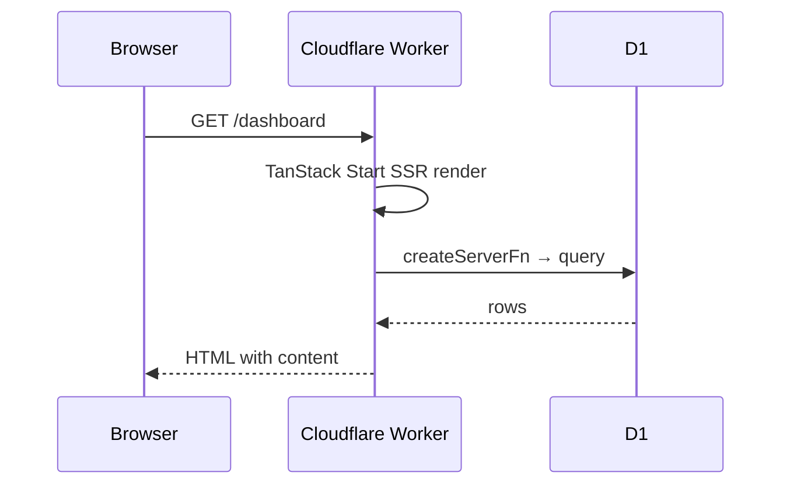
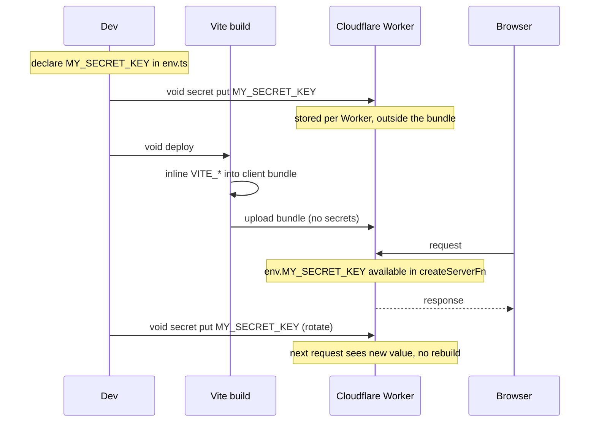
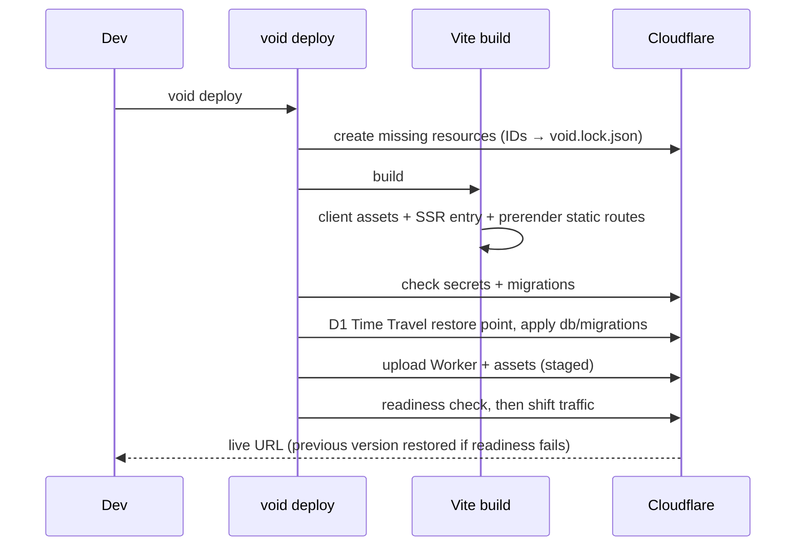

# TanStack Start on Cloudflare

Conventions for full-stack TypeScript apps on Bun + TanStack Start, running entirely on Cloudflare. Source of truth for stack choices, layout, integrations, and deploy. Deviate only with explicit reason.

**Everything is a Cloudflare binding.** No external database, no external mail provider, no separate API server. One Worker, one `void deploy`.

## Stack

| Layer        | Choice                                          |
| ------------ | ----------------------------------------------- |
| Dev runtime  | Bun (package manager, scripts)                  |
| Prod runtime | Cloudflare Workers (V8 isolate)                 |
| Language     | TypeScript (strict)                             |
| Framework    | TanStack Start (React 19 + TanStack Router)     |
| Build        | Vite + `voidPlugin()` (wraps the Cloudflare Vite plugin) |
| API          | Server functions + route `server.handlers`      |
| ORM          | Drizzle (migrations via `void db`)              |
| Database     | Cloudflare D1 (SQLite)                          |
| Auth         | Better Auth                                     |
| Email        | Cloudflare Email Sending (`send_email` binding) |
| CSS          | Tailwind v4 (`@tailwindcss/vite`)               |
| UI           | shadcn/ui (Radix + Tailwind) + lucide-react     |
| Forms        | TanStack Form                                   |
| Validation   | Zod                                             |
| Logs         | Workers Observability (`console` + Workers Logs, `void project logs`)|
| Test         | Vitest + `@cloudflare/vitest-plugin`            |
| Deploy       | `bunx void deploy` (Void CLI)                   |

### Non-negotiables

- Bun is only the package manager and script runner — never `npm` / `pnpm` / `yarn` / `node`. Dev, test, and prod code all run on workerd (a V8 isolate, not Node or Bun): use Web-standard APIs (`fetch`, Web Crypto, Streams), never `Bun.*` / `bun:*`.
- **Bindings are request-time.** Build the DB client and Better Auth inside the handler, never at module top level, and never cache per-user state at module scope. Isolates are reused across requests and across a binding or secret change, so anything built at module scope can be stale.
- TypeScript `strict: true` everywhere.
- Do not install: `dotenv`, `ts-node`, `tsx`, `nodemon`, `jest`, `bcrypt`, `argon2`, `node-fetch`, `nodemailer`, `winston`, `bunyan`, `pino`, `express`.
- **Versions**: pin `"@tanstack/react-start": "^1.168"` and `"void": "^1.2"`, bump deliberately. The Void CLI must match the installed package or Cloudflare deploys refuse to run.
- Vitest is the test runner, always through `@cloudflare/vitest-plugin` so tests run in workerd with real bindings. Not `bun test`, not `jest`.

### Deliberately unconfigured

No formatter/linter, no git hooks, no CI pipeline — deferred, not rejected. Nothing in this skill depends on them, so adding them later is additive. When that day comes: Biome for lint/format, lefthook for hooks, GitHub Actions from `bunx void init --github`, running the pre-deploy checks listed under Deploy.

### Add only when the need is real

Everything below is **not** in the default stack. Add one when the listed condition is actually hit, not in anticipation.

| Need                                                       | Add                                                    |
| ---------------------------------------------------------- | ------------------------------------------------------ |
| Relational workload D1 can't hold (>10 GB, Postgres-only SQL) | `database: 'pg'` in `void.config.ts` + `DATABASE_URL` (Void provisions Hyperdrive) |
| Semantic search, RAG, similarity over text                  | Workers AI (embeddings) + **Vectorize** binding (native vector store on Workers) |
| Append-only time-series analytics (signups, feature-flag hits, email opens) | **Workers Analytics Engine** binding (SQL-queryable, no extra infra) |
| Long-running or multi-step background jobs (cleanup, digests, reports) | Cloudflare **Queues** (consumers) / **Workflows** (durable, retryable, step-based) |
| Scheduled jobs (cleanup, digests, reports)                 | A handler in `crons/` (Void provisions the Cron Trigger) |
| Realtime / WebSocket app (presence, collaboration)         | Durable Object with **WebSocket Hibernation**           |
| Strong consistency, atomic counters, single-writer state   | Durable Object                                         |
| Headless Chrome (PDF/screenshot, scraping)                 | Workers **Browser Run** (formerly Browser Rendering) binding |
| Long-lived non-V8 task (ffmpeg, heavy CPU, GPU)            | Cloudflare **Containers**                               |
| User uploads / large media                                 | R2 binding — serve via a route handler, no S3 SDK       |
| Read-heavy cache, feature flags, config at the edge        | KV binding (`env.KV`) — eventually consistent, not for counters |
| AI features (chat, classification, embeddings)              | Workers AI binding — no external API key               |
| Rate limits on non-auth routes                             | Cloudflare `ratelimits` binding                        |
| Bot protection on signup / public forms                    | Cloudflare Turnstile — free, no CAPTCHA friction       |
| Admin panel auth / internal tooling                        | Cloudflare Access (Zero Trust) — no custom auth code    |
| Centralized secret governance across Workers               | **Cloudflare Secrets Store** binding (vs per-Worker `void secret put`) |
| Private network path to on-prem DB                         | Workers **VPC** binding (open beta)                     |
| Marketing email, templates, campaign analytics             | Resend + React Email (transactional stays on the binding) |
| Error alerting / release tracking beyond Workers Logs      | `@sentry/cloudflare` + `@sentry/tanstackstart-react`   |
| Standalone API with many middleware layers or OpenAPI      | Hono, mounted at `src/routes/api/$.ts`                 |
| Second language                                            | i18n lib of choice — do not hand-roll                  |

## Architecture

- CRUD → **server functions** co-located with components. Webhooks, files, anything non-React → **route `server.handlers`** (`src/routes/api/*.ts`).
- One **Zod schema** per concept in `src/schemas/`, shared by server fn / Form / validation.

### Rendering strategy

| Route type                              | Mode         | How                                                                 |
| --------------------------------------- | ------------ | ------------------------------------------------------------------- |
| Data-independent (landing, blog, about) | Static (SSG) | `tanstackStart({ prerender: { enabled: true } })` in `vite.config.ts` |
| Per-request data (dashboard, account)   | Server (SSR) | default                                                             |
| Purely client-rendered                  | CSR          | `ssr: false` route option in `createFileRoute(...)({ ... })`        |

Prerendered routes serve flat HTML from the CDN with no Worker invocation — use them for everything that doesn't read per-user data.

Default to SSR, not CSR: search crawlers and link-preview bots read the first HTML response, and a CSR shell has no content or per-page meta tags in it. SSR runs loaders in the Worker and returns finished HTML in one round trip:



### Execution model

Code is **isomorphic by default**: route modules, loaders, and components land in both the server and client bundles. Server-only or client-only code is marked with an explicit boundary.

`createServerFn` is that boundary. The Start Vite plugin transforms it at build time: the server bundle keeps the handler body; the client bundle replaces it with a typed `fetch` stub that calls the server-fn endpoint (GET by default, POST with `createServerFn({ method: 'POST' })`). Write it like a normal function, import it anywhere, keep it next to the component — one file, one deploy, end-to-end types from call site to handler. No separate API service.

## Project structure

```
src/
├── routes/
│   ├── __root.tsx
│   ├── index.tsx
│   └── api/auth/$.ts             # Better Auth handler
├── db/index.ts                   # Drizzle client (from D1 binding)
├── lib/
│   ├── auth.ts, auth-client.ts
│   ├── auth.shared.ts            # schema-affecting auth options (runtime + CLI)
│   ├── auth.cli.ts               # only for `@better-auth/cli generate`
│   └── email.ts                  # void/email wrapper (throws on failure)
├── schemas/                      # shared Zod schemas
├── components/{ui,forms}/
├── styles/app.css                # @import "tailwindcss"
├── start.ts                      # global request middleware (security headers)
├── server.ts                     # optional custom Worker entry (Durable Object / Workflow exports)
└── router.tsx
db/                               # Void convention, project root (not src/)
├── schema.ts                     # business tables + `export * from './auth-schema'`
├── auth-schema.ts                # Better Auth (CLI-generated, do not edit)
└── migrations/                   # generated by `void db generate`
queues/email.ts                   # queue consumer (Void convention)
.env                              # local values only, gitignored (no .dev.vars)
env.ts                            # declares every server value; `void secret put` refuses undeclared names
void.config.ts, void.lock.json    # commit both; .void/ and .void-wrangler.jsonc are generated, gitignored
test/apply-migrations.ts          # Vitest setup: applies db/migrations to the test D1
vite.config.ts, vitest.config.ts
```

## Setup

### Scaffold

```bash
# Official TanStack CLI — pick Bun as package manager when prompted.
# `bun create tsrouter-app@latest my-app` still works as a legacy alias.
bunx @tanstack/cli@latest create my-app && cd my-app
```

### Install

```bash
# Runtime
bun add drizzle-orm better-auth zod @tanstack/react-form tailwindcss @tailwindcss/vite

# Dev
bun add -d void @vitejs/plugin-react                  # void brings the Cloudflare Vite plugin, Drizzle Kit, and the deploy CLI
bun add -d vitest @cloudflare/vitest-plugin           # plugin peer: vitest ^4.1 || ^5

# UI
bunx shadcn@latest init
```

### Provision Cloudflare resources

Write `void.config.ts` by hand (see Configuration), then connect. Void infers bindings from code (`env.DB` → D1, `env.KV` → KV if you add it, `env.STORAGE` → R2, `env.AI` → Workers AI, a file in `queues/` → a Queue), creates missing resources on the first `void deploy`, and records their IDs in `void.lock.json`. The email domain is set up from `email.from` in `void.config.ts` (Void asks before changing DNS).

```bash
bunx void connect --platform cloudflare   # log in and save Cloudflare as the deploy target
```

Run the first deploy from one machine and commit `void.lock.json` before deploying from anywhere else — a parallel first deploy provisions duplicates.

### Auth schema & migrations

```bash
# The CLI can't read getAuth() (it needs an exported `auth` instance), so point it at auth.cli.ts.
# On first run db/schema.ts must not yet re-export ./auth-schema — add that line after this step.
bunx @better-auth/cli generate --config src/lib/auth.cli.ts --output db/auth-schema.ts

# Migrations: Void reads db/schema.ts and writes SQL + Drizzle metadata to db/migrations/.
bunx void db generate
bunx void db migrate          # apply to the local D1 (`vite dev` also applies pending ones on start)
# Remote is applied by `void deploy` (after a D1 Time Travel restore point).
```

### Regenerate Env types

```bash
# Re-run after changing bindings or void.config.ts; writes types under .void/.
bunx void prepare
```

## Integration patterns

### Drizzle over D1

D1 is a binding, not a connection string — no pool, no driver, no `DATABASE_URL`. Read the binding inside the request.

```ts
// src/db/index.ts
import { drizzle } from 'drizzle-orm/d1'
import { env } from 'cloudflare:workers'
import * as schema from '../../db/schema' // re-exports auth-schema; relative so tsc and Vitest resolve it too

// Call inside a handler. Bindings are request-scoped — never at module top level.
export const getDb = () => drizzle(env.DB, { schema })
export type DB = ReturnType<typeof getDb>
```

```ts
// db/schema.ts — SQLite tables, not pg
import { integer, sqliteTable, text } from 'drizzle-orm/sqlite-core'

export const posts = sqliteTable('posts', {
  id: text('id').primaryKey(),
  title: text('title').notNull(),
  body: text('body').notNull(),
  createdAt: integer('created_at', { mode: 'timestamp_ms' }).notNull(),
})

export * from './auth-schema'
```

Workflow: `void db generate` writes SQL into `db/migrations/`; `void db migrate` applies it locally; `void deploy` applies it remotely. No `drizzle.config.ts`, no `drizzle-kit` — Void owns the schema path and migration history, and deploy stops if the schema has changes without a migration.

#### If you outgrow D1 and switch to Postgres

Postgres on Workers **must** go through Hyperdrive — an isolate can't hold a long-lived TCP connection across requests, and Hyperdrive pools them at the edge. Void wires this up:

1. Set `database: 'pg'` in `void.config.ts`; put `DATABASE_URL` in `.env` locally and in the shell that runs `void deploy` (Void creates Hyperdrive from it and runs migrations against it directly — it is never written to config).
2. Schema moves to `pg-core` (or `void/schema-pg`); Better Auth adapter goes `provider: 'sqlite'` → `'pg'`.
3. Query through `db` from `void/db` — it connects via Hyperdrive in production and directly in dev, so `getDb()` goes away.
4. Keep `nodejs_compat`.

For routes with several DB round trips, consider Smart Placement so the Worker runs closer to the database — but not on asset-heavy Workers.

### Better Auth

Better Auth needs the DB, so it is request-scoped too.

```ts
// src/lib/auth.ts
import { betterAuth } from 'better-auth'
import { drizzleAdapter } from 'better-auth/adapters/drizzle'
import { tanstackStartCookies } from 'better-auth/tanstack-start'
import { env } from 'void/env' // typed from env.ts
import { getDb } from '~/db'
import { sendEmail } from '~/lib/email'
import { schemaOptions } from '~/lib/auth.shared'

export function getAuth() {
  return betterAuth({
    ...schemaOptions,
    database: drizzleAdapter(getDb(), { provider: 'sqlite' }),
    // Signed session cookie skips the D1 lookup on most requests.
    session: { cookieCache: { enabled: true, maxAge: 5 * 60 } },
    // Cloudflare puts the client IP here; without it the limiter shares one bucket per path.
    advanced: { ipAddress: { ipAddressHeaders: ['cf-connecting-ip'] } },
    secret: env.BETTER_AUTH_SECRET,
    baseURL: env.PUBLIC_ORIGIN,
    emailAndPassword: {
      enabled: true,
      requireEmailVerification: true,
      sendResetPassword: ({ user, url }) =>
        sendEmail(user.email, 'Reset your password', `<a href="${url}">Reset your password</a>`),
    },
    emailVerification: {
      sendVerificationEmail: ({ user, url }) =>
        sendEmail(user.email, 'Verify your email', `<a href="${url}">Verify your email</a>`),
    },
    socialProviders: {
      google: { clientId: env.GOOGLE_CLIENT_ID, clientSecret: env.GOOGLE_CLIENT_SECRET },
      github: { clientId: env.GITHUB_CLIENT_ID, clientSecret: env.GITHUB_CLIENT_SECRET },
    },
    // tanstackStartCookies must be the LAST plugin in the array.
    plugins: [...schemaOptions.plugins, tanstackStartCookies()],
  })
}
```

```ts
// src/lib/auth.shared.ts — every option that changes the DB schema, shared with the CLI config
import type { BetterAuthOptions } from 'better-auth'

export const schemaOptions = {
  // Built-in limiter on D1 (adds a `rateLimit` table) — do not hand-roll one. Not KV:
  // secondary-storage limiting needs an atomic increment and KV's TTL floor is 60 s.
  rateLimit: { enabled: true, storage: 'database', customRules: { '/sign-in/email': { window: 60, max: 5 } } },
  plugins: [], // table-adding plugins (phoneNumber, organization, ...) go here
} satisfies BetterAuthOptions
```

```ts
// src/lib/auth.cli.ts — read only by `@better-auth/cli generate`; never imported at runtime
import { betterAuth } from 'better-auth'
import { drizzleAdapter } from 'better-auth/adapters/drizzle'
import { schemaOptions } from './auth.shared'

// The adapter only needs the provider to emit a schema; no database is touched.
export const auth = betterAuth({ ...schemaOptions, database: drizzleAdapter({}, { provider: 'sqlite' }) })
```

```ts
// src/routes/api/auth/$.ts
import { createFileRoute } from '@tanstack/react-router'
import { getAuth } from '~/lib/auth'

const handler = ({ request }: { request: Request }) => getAuth().handler(request)

export const Route = createFileRoute('/api/auth/$')({
  server: { handlers: { GET: handler, POST: handler } },
})
```

```ts
// src/lib/auth-client.ts
import { createAuthClient } from 'better-auth/react'
export const authClient = createAuthClient()
export const { signIn, signOut, signUp, useSession } = authClient
```

Server-side session, inside a `createServerFn` handler or route `beforeLoad`:

```ts
// inside a server fn / beforeLoad
import { getRequestHeaders } from '@tanstack/react-start/server'
const session = await getAuth().api.getSession({ headers: getRequestHeaders() })
```

Providers beyond the built-ins:

- **Phone OTP** → `phoneNumber` plugin from `better-auth/plugins`; supply `sendOTP` (SMS provider is yours).
- **WeChat** → `genericOAuth` plugin from `better-auth/plugins`; WeChat is not a built-in provider.

Re-run `bunx @better-auth/cli generate --config src/lib/auth.cli.ts --output db/auth-schema.ts` + `bunx void db generate` after changing `auth.shared.ts` — plugins and `rateLimit.storage` add tables. Schema-affecting options belong in `auth.shared.ts`, or the CLI generates the wrong schema. Void-managed auth (`void/auth`) is not supported for TanStack Start yet; Better Auth stays wired by hand as above.

### Email (Cloudflare Email Sending)

Cloudflare Email Sending is in public beta. No API key — `sendEmail` from `void/email` sends through the Cloudflare `send_email` binding in production. Sender comes from `email.from` in `void.config.ts`. Void's docs promise a local dev inbox, but in a TanStack Start app on `void@1.2.1` dev sends returned `BINDING_MISSING` — verify email flows on a deployed Worker, not in dev.

```ts
// src/lib/email.ts
import { sendEmail as voidSend } from 'void/email'

export async function sendEmail(to: string, subject: string, html: string) {
  const result = await voidSend({
    to,
    subject,
    html,
    text: html.replace(/<[^>]+>/g, ' ').trim(), // clients that only show plain text
  })
  // void/email returns a result instead of throwing — surface failures so
  // Better Auth's verify/reset flows don't silently "succeed".
  if (!result.ok) throw new Error(`sendEmail failed: ${JSON.stringify(result)}`)
}
```

`void deploy` checks the `email.from` domain and offers to set it up (it must be a zone on your account). Sending to arbitrary recipients needs Workers Paid; Free only reaches verified destination addresses. Transactional only — marketing sends belong on a marketing platform.

### R2 (not in the base stack)

Add it when there are actual uploads. Reading `env.STORAGE` is enough — Void infers the R2 binding and creates the bucket on deploy.

Serve it through a route handler, never an S3 SDK. Reads are the mirror image: `env.STORAGE.get(key)` → `new Response(obj.body, { headers: { 'content-type': obj.httpMetadata?.contentType } })`, 404 when `null`. Authorize writes **before** calling `env.STORAGE.put()` — the route handler is the trust boundary, not R2. For large or direct-from-browser uploads, put the bucket behind a custom domain or issue presigned URLs instead of streaming through the Worker.

```ts
// src/routes/api/files/upload.ts — authorized PUT
import { createFileRoute } from '@tanstack/react-router'
import { env } from 'cloudflare:workers'
import { getAuth } from '~/lib/auth'
import { getRequestHeaders } from '@tanstack/react-start/server'

export const Route = createFileRoute('/api/files/upload')({
  server: {
    handlers: {
      PUT: async ({ request }) => {
        const session = await getAuth().api.getSession({ headers: getRequestHeaders() })
        if (!session) return new Response('Unauthorized', { status: 401 })

        const key = `${session.user.id}/${crypto.randomUUID()}`
        await env.STORAGE.put(key, request.body, {
          httpMetadata: { contentType: request.headers.get('content-type') ?? 'application/octet-stream' },
        })
        return Response.json({ key })
      },
    },
  },
})
```

### Queues & Workflows (background work)

Queues for at-least-once consumers; Workflows for durable, step-based, retryable orchestration.

A file in `queues/` is a consumer; its path is the queue name. Void provisions the queue and wires the handler — no Worker config, no custom entry.

```ts
// queues/email.ts
import { defineQueue } from 'void'
import { sendEmail } from '../src/lib/email' // relative: queues/ sits outside src/

export type EmailOutbound = { to: string; subject: string; html: string }

export default defineQueue<EmailOutbound>(async (batch) => {
  for (const m of batch.messages) {
    try { await sendEmail(m.body.to, m.body.subject, m.body.html); m.ack() }
    catch { m.retry({ delaySeconds: 60 }) }
  }
})
```

```ts
// producer, inside a server fn — typed from the consumer's generic
import { queues } from 'void/queues'
await queues.email.send({ to, subject, html })
```

There is no dead-letter queue: after `maxRetries` (default 3) Cloudflare drops the message, so make failures visible in logs. Cron jobs follow the same pattern in `crons/`. Durable Object and Workflow classes still need a custom entry: set `cloudflare: { main: './src/server.ts' }` in `void.config.ts`, `export default handler` from `@tanstack/react-start/server-entry` there, add the class as a named export, and bind it under `cloudflare.durable_objects` / `cloudflare.workflows`.

### Security headers

One global middleware, applied to every request including SSR and server functions.

```ts
// src/start.ts
import { createCsrfMiddleware, createMiddleware, createStart } from '@tanstack/react-start'
import { setResponseHeader } from '@tanstack/react-start/server'

const securityHeaders = createMiddleware().server(({ next }) => {
  // setResponseHeader records state Start applies to the final response.
  // getResponseHeaders() is a read-only snapshot — .set() on it does nothing.
  setResponseHeader('X-Content-Type-Options', 'nosniff')
  setResponseHeader('X-Frame-Options', 'DENY')
  setResponseHeader('Referrer-Policy', 'strict-origin-when-cross-origin')
  setResponseHeader('Strict-Transport-Security', 'max-age=31536000; includeSubDomains')
  return next()
})

export const startInstance = createStart(() => ({
  // createStart replaces the default requestMiddleware list, so the CSRF
  // middleware that Start auto-installs when no start.ts exists must be
  // re-added explicitly — otherwise server functions lose same-origin protection.
  // Filter to server fns: unfiltered, it 403s typed URLs and links from other sites.
  requestMiddleware: [
    createCsrfMiddleware({ filter: (ctx) => ctx.handlerType === 'serverFn' }),
    securityHeaders,
  ],
}))
```

**No CORS config.** The app and its API are same-origin. Add `cors` only if a different origin genuinely calls the API.

### TanStack Form + Zod

One schema, both sides.

```ts
// src/schemas/post.ts
import { z } from 'zod'
export const postInput = z.object({ title: z.string().min(1).max(200), body: z.string().min(1) })
export type PostInput = z.infer<typeof postInput>
```

```ts
// inside a component
const form = useForm({
  defaultValues: { title: '', body: '' },
  validators: { onSubmit: postInput },
  onSubmit: async ({ value }) => createPost({ data: value }),
})
```

Server functions parse with the same schema before touching the DB — client validation is UX, not a trust boundary.

## Configuration

### Vite + Tailwind v4

```ts
// vite.config.ts
import { tanstackStart } from '@tanstack/react-start/plugin/vite'
import tailwindcss from '@tailwindcss/vite'
import viteReact from '@vitejs/plugin-react'
import { defineConfig } from 'vite'
import { voidPlugin } from 'void'

export default defineConfig({
  plugins: [
    voidPlugin(), // must come before tanstackStart(); replaces @cloudflare/vite-plugin
    tanstackStart(),
    viteReact(),
    tailwindcss(),
  ],
})
```

```css
/* src/styles/app.css */
@import "tailwindcss";

@theme {
  --color-brand: oklch(0.7 0.18 250);
  --font-display: "Inter", sans-serif;
}
```

No `tailwind.config.js` — tokens live in `@theme`. shadcn/ui must use its v4 mode.

### void.config.ts

There is no `wrangler.toml`. Authored settings live in `void.config.ts`; provisioned IDs live in `void.lock.json` (commit both). Void generates `.void/` and `.void-wrangler.jsonc` — gitignore them, never edit them. Deleting `void.lock.json` makes the next deploy provision new resources.

```ts
// void.config.ts
import { defineConfig } from 'void/config'

export default defineConfig({
  worker: {
    compatibility_date: '2026-10-15', // a few days back: the workerd bundled with Void lags, and a newer date fails `vite dev`
    compatibility_flags: ['nodejs_compat'],
  },
  email: { from: 'My App <hello@example.com>' },
  cloudflare: {
    name: 'my-app',
    observability: { enabled: true },
  },
})
```

```ts
// env.ts — every server value the app reads; void deploy fails if a required one is missing remotely
import { defineEnv, string, url } from 'void/env'

export default defineEnv({
  PUBLIC_ORIGIN: url(), // non-secret, but declared here so it's typed; set it like a secret
  BETTER_AUTH_SECRET: string(),
  GOOGLE_CLIENT_ID: string(),
  GOOGLE_CLIENT_SECRET: string(),
  GITHUB_CLIENT_ID: string(),
  GITHUB_CLIENT_SECRET: string(),
})
```

Declare every server value here, secret or not: `void/env` types only `env.ts` keys (a `worker.vars` value reads as `unknown`), production builds reject a key that is in both, and a `.default()` was not applied at runtime in dev — so make keys required and set them in `.env` / with `void secret put`.

D1 (`env.DB`), KV (`env.KV`, if used), R2 (`env.STORAGE`), Workers AI (`env.AI`), and queues are inferred — don't declare them. Bindings Void doesn't infer (`ratelimits`, Vectorize, Analytics Engine, service bindings, Durable Objects) go under `cloudflare` with the usual Wrangler field names; Void passes them through.

`nodejs_compat` is for Better Auth and React SSR internals, not a database driver.

### Environment variables

| Scope                | Convention     | Access                                        |
| -------------------- | -------------- | --------------------------------------------- |
| Public (client-safe) | `VITE_` prefix | `import.meta.env.VITE_FOO`                    |
| Server values        | `env.ts`       | `env.FOO` from `void/env` (typed, validated)  |
| Bindings (D1, R2, …) | inferred       | `env.DB` from `cloudflare:workers`            |

- Set server values with `void secret put NAME` (bulk: `void secret sync <file>`) — both refuse names not declared in `env.ts`. Local values live in the root `.env`; deploy never uploads it, and `.dev.vars` is not read.
- Secrets are injected at request time, never bundled, so a rotation takes effect without a rebuild.
- `process.env` is also populated (`nodejs_compat`, date ≥ 2025-04-01) for Node-style libraries; app code still uses `void/env` and `cloudflare:workers`.
- Builds ignore `VITE_*` from `.env` — pass production public values in the shell (`VITE_FOO=... void deploy`).



### TypeScript

`tsconfig.json`: `strict`, `moduleResolution: "bundler"`, `verbatimModuleSyntax: true`, alias `"~/*": ["./src/*"]`. Run `bunx void prepare`, then `bunx void init --tsconfig`: it adds `"extends": "./.void/tsconfig.json"` and merges Void's `paths` (`void/queues`, `@schema`) into yours — the TanStack scaffold's own `paths` otherwise shadows them and `queues.email` stops type-checking. It also writes Void's `.gitignore` entries. Do not hand-write `Env`. Add `"@cloudflare/vitest-plugin/types"` to `types` for `cloudflare:test`.

### Observability

`console.log` an object (`{ traceId, event, ... }`) — Workers Logs captures it when `cloudflare.observability.enabled` is on; no log library. Tail live with `bunx void project logs`; ship to R2 via Logpush only if you need retention beyond Workers Logs.

## Deploy

Vite builds, Void deploys. One command from a clean checkout (first run opens a browser to log in to Cloudflare):

```bash
bunx void deploy
```



Before deploying, run the checks CI would have run: `bunx void prepare`, `bunx tsc --noEmit`, and `bunx vitest run`.

After deploying: `void project status`, `void project logs`, `void project rollback`. Rollback does **not** reverse migrations — restore D1 with the `void db restore` command deploy printed (restore points last 7 days on Workers Free, 30 on Paid), or write a new migration.

## Testing

Vitest through `@cloudflare/vitest-plugin` (the renamed `@cloudflare/vitest-pool-workers`) — tests run in workerd with real local D1 instead of mocks. Storage is isolated per test file, so migrations are applied in a setup file rather than taken from `void db migrate`.

```ts
// vitest.config.ts — bindings declared directly, no dependency on Void's generated config
import { cloudflareTest, readD1Migrations } from '@cloudflare/vitest-plugin'
import { defineConfig } from 'vitest/config'

export default defineConfig(async () => ({
  plugins: [
    cloudflareTest({
      miniflare: {
        compatibilityDate: '2026-10-15', // keep in step with void.config.ts
        compatibilityFlags: ['nodejs_compat'],
        d1Databases: ['DB'],
        bindings: { TEST_MIGRATIONS: await readD1Migrations('./db/migrations') }, // reads top-level *.sql, skips meta/
      },
    }),
  ],
  test: { setupFiles: ['./test/apply-migrations.ts'] },
}))
```

```ts
// test/apply-migrations.ts
import { applyD1Migrations, type D1Migration } from 'cloudflare:test'
import { env } from 'cloudflare:workers'

declare global {
  namespace Cloudflare { interface Env { TEST_MIGRATIONS: D1Migration[] } }
}

await applyD1Migrations(env.DB, env.TEST_MIGRATIONS)
```

```ts
// db/posts.test.ts
import { env } from 'cloudflare:workers'
import { expect, test } from 'vitest'
import { drizzle } from 'drizzle-orm/d1'
import { posts } from './schema'

test('inserts a post', async () => {
  const db = drizzle(env.DB, { schema: { posts } })
  await db.insert(posts).values({ id: '1', title: 't', body: 'b', createdAt: new Date() })
  expect(await db.select().from(posts)).toHaveLength(1)
})
```

`bunx vitest` (watch) / `bunx vitest run` (once) / `--coverage` (Istanbul provider — V8 coverage doesn't work in workerd). Never mock the ORM — the plugin gives you a real local D1.

## Operational patterns

### Error handling & trace IDs

Wrap every server function / route handler in a single try/catch that logs a structured object with a per-request trace ID, then rethrows or returns a normalized error. The trace ID lets a `void project logs` session follow one request end-to-end across server fn → DB → email.

```ts
// src/lib/trace.ts
export function newTraceId() {
  return crypto.randomUUID()
}

export function logCtx(traceId: string, event: string, fields: Record<string, unknown> = {}) {
  console.log({ traceId, event, ...fields })
}
```

```ts
// src/utils/posts.functions.ts
import { createServerFn } from '@tanstack/react-start'
import { z } from 'zod'
import { getDb } from '~/db'
import { posts } from '~/db/schema'
import { newTraceId, logCtx } from '~/lib/trace'

const createPostSchema = z.object({ title: z.string().min(1).max(200), body: z.string().min(1) })

export const createPost = createServerFn({ method: 'POST' })
  .validator(createPostSchema)
  .handler(async ({ data }) => {
    const traceId = newTraceId()
    try {
      logCtx(traceId, 'createPost.start', { title: data.title })
      const db = getDb()
      const [post] = await db.insert(posts).values({ id: crypto.randomUUID(), ...data, createdAt: new Date() }).returning()
      logCtx(traceId, 'createPost.ok', { id: post.id })
      return post
    } catch (e) {
      logCtx(traceId, 'createPost.error', { message: (e as Error).message })
      throw new Error('Failed to create post')
    }
  })
```

### ID generation

- **Primary keys are `text`, not auto-increment integers and not a `uuid` column type** (D1 has none). Generate ids in app code with `crypto.randomUUID()` (built into Web Crypto on Workers) or an ULID (`ulid` pkg) if you need time-sortable ids.
- **Timestamps are integer Unix-ms** with Drizzle `integer('...', { mode: 'timestamp_ms' })` (`'timestamp'` stores seconds). Drizzle maps them to `Date` in app code; do not mix `Date` objects and raw numbers across the wire — pick one and validate it with Zod at the server boundary.

### Migration discipline

- `db/migrations/` (SQL + `meta/`) is **generated**, never hand-edited. Change the schema in `db/schema.ts`, run `void db generate`, commit both.
- A PR that touches `db/schema.ts` **must** include the matching migration — `void deploy` refuses to deploy a schema with unmigrated changes.
- `void db migrate` applies locally; `void deploy` applies remotely. Never edit a migration after it has been deployed — write a new migration instead. `void db status` shows drift and pending migrations.

## Gotchas

- **D1 is SQLite**: no `jsonb`, no `uuid` type (ids are `text`), integer timestamps — `RETURNING` works (SQLite ≥ 3.35). Use `drizzle-orm/sqlite-core`, not `pg-core`.
- **D1 limits**: 10 GB per database (paid; 500 MB free), 2 MB max row/BLOB, 100 KB max statement, 30 s max query, 1000 queries per invocation (50 on Workers Free). Writes hit a single-region primary. Void enables read replication on databases it provisions, but a bare `drizzle(env.DB)` reads from the primary unless you open a session with `env.DB.withSession()`. Past these limits, switch to Hyperdrive + Postgres.
- **KV is eventually consistent** and read-cached (~60s), with no atomic increment and a 60 s minimum TTL: fine for read-heavy caches, wrong for sessions that must revoke immediately, rate-limit counters, or one-time tokens — use D1 or a Durable Object there.
- **Rate limiting**: Better Auth's built-in limiter covers auth routes. For others use the `ratelimits` binding (`period` is 10 or 60 seconds only, and counts are per-colo, not global).
- **`compatibility_date` drift**: an old date silently disables newer compatibility-flag defaults; a date newer than the installed workerd supports fails `vite dev` ("newest date supported by this server binary is …"). Bump `worker.compatibility_date` at least quarterly, to a date a few days old; the email/D1/ratelimits bindings need a recent date for the latest binding semantics.
- **No named environments**: Void doesn't support Wrangler `[env.*]`. Staging is a separate Void project config.

## Rules for AI

**File naming** (TanStack official):

- `*.functions.ts` — `createServerFn` wrappers, safe to import anywhere
- `*.server.ts` — server-only code (DB queries, secret reads)
- `*.ts` (no suffix) — client-safe code (types, schemas, constants)

`@tanstack/react-start/server-only` marks a module server-only; importing it from the client is a build error.

**Rules**:

- Use `createServerFn`, never `"use server"` directives (Next.js pattern).
- Use TanStack Router, not React Router. Loaders fetch data — never `getServerSideProps` / `getStaticProps`.
- Place server functions next to the component that uses them. Group by feature, not by layer.
- Reach for a binding before a package: D1 before an external DB, R2 before an S3 SDK, `send_email` before a mail SDK, `ratelimits` before a hand-rolled limiter, Vectorize before a hosted vector DB, Queues/Workflows before an external job runner.
- Provision, migrate, set secrets, and deploy with the `void` CLI — not `wrangler`. Don't write a `wrangler.toml`.
- No `any`, no `as unknown as X`. If a type assertion feels necessary, widen the schema or the return type.
- Server function inputs and outputs must be serializable (Zod-validated in, JSON-safe out). `FormData` is allowed for POST server fns; `Response` is allowed as a return.
